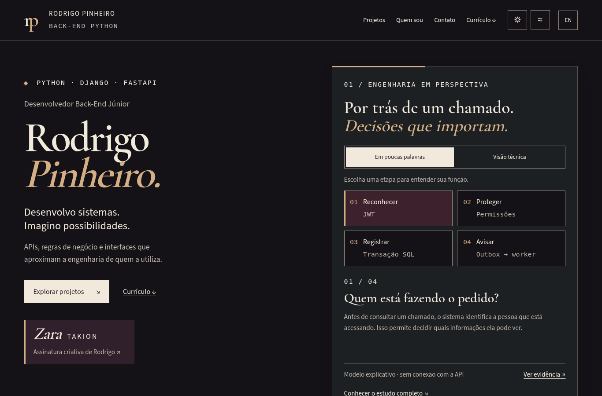
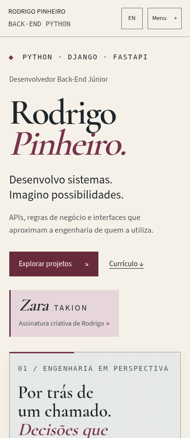

# Integração Ateliê Obsidiana V4.2 — revisão da PR #15

Direção visual integrada na branch `feat/obsidiana-v42-review`. A PR permanece **draft**. Esta entrega não autoriza release e não executa merge, deploy, atualização de Worker ou mudança de credenciais.

## Comparação da base com a integração

| Área | Base publicada V3 | Integração V4.2 |
| --- | --- | --- |
| Entrada | React desktop Aqua | React/TS com Ateliê Obsidiana, PT/EN e pré-renderização |
| Interação | Janelas, terminal e paleta | Header, preferências, percurso do Chamados, diagrama da transação, perfis Campus e contrato Task Manager |
| Conteúdo | Catálogo e capturas auditados | Catálogo preservado; cadernos de decisão específicos e links de evidência fixados por commit |
| Tipografia | Tema Aqua | Fontes locais OFL; legendas e identificações com mínimo de 14 px, reflow de texto a 200% |
| Imagens | Inclui ilustração Zara no artefato | Originais preservados em `site/`; saída restrita às quatro capturas do manifesto. Sem foto pessoal ou ilustração Zara |
| Build | Vite + cópia dos recursos da base | Mesmas rotas e entrypoint Python, Vite client/SSR, cópia seletiva e manifesto Git |
| CI | Tipos, Vitest, Node, Python, auditorias e navegador | Todos os gates preservados; regressões da interface antiga substituídas por testes da UX V4.2 |

Os dois ZIPs foram extraídos fora do checkout. Seus SHA-256 estão em [SOURCE_EVIDENCE.json](SOURCE_EVIDENCE.json). Os manifestos internos foram conferidos: **140 arquivos V4.2 e 106 arquivos V4.1, sem divergências**. Não foram importados `dist/`, lockfile, CI reduzida, relatórios antigos, `api/`, `site/` ou `wrangler.jsonc` do ZIP. Foram importados seletivamente os componentes, conteúdo, estilos, entradas React e recursos autorizados; os scripts foram conciliados com a base.

O código ativo está em `src/v42/`. Os nomes experimentais `v41` e `proposal42` foram consolidados nesse diretório. O material V3 continua preservado na base, sem ser importado no bundle V4.2. `site/`, `api/` e `wrangler.jsonc` continuam byte a byte iguais à base `c9d6036`.

## Rastreabilidade e metadados

`npm run build` gera uma revisão local **noindex**. `version.json` mantém o identificador `site` existente e inclui versão 4.2.0, `stage`, SHA completo de `git rev-parse HEAD`, `shortRevision`, `revisionSource` e `dirty`. O SHA é do checkout real; variáveis como `GITHUB_SHA` não podem mascará-lo. Alterações não commitadas são explicitadas por `dirty=true`.

Sem Git, preview retorna `revision=null`, `shortRevision=null`, `revisionSource=unavailable`. Um candidato de produção sem Git ou com checkout sujo falha antes de alterar a saída existente. Essas situações são testadas em repositório temporário real.

`npm run build:production` apenas constrói um candidato **local**: metadados de indexação, canonical, alternates, sitemap/robots originais e SHA real. Não contém comando de deploy. Preview não aponta canonical para a produção, omite URLs do sitemap e acrescenta `X-Robots-Tag: noindex, nofollow`. A CSP e as rotas de privacidade/404 da base continuam presentes.

## Proteção contra publicação automática

A integração existente tentou criar preview na PR. Por isso `scripts/build.mjs` interrompe builds hospedados identificados por `WORKERS_CI`, `NETLIFY` ou `CF_PAGES` **antes** de compilar e antes do comando de deploy do provedor. Os comandos locais e o GitHub Actions de qualidade continuam executáveis. `python scripts/build_site.py` continua chamando o mesmo build npm e usa `npm ci` quando precisa instalar dependências.

A proteção foi exercitada com os três ambientes: cada comando encerrou com erro esperado e deixou o build existente intacto ([resultado](evidence/publication-guard.json)). Um check de preview Cloudflare/Netlify bloqueado é deliberado nesta fase; não deve ser confundido com falha da CI de qualidade. A configuração do Worker não foi alterada. A futura release precisará de autorização separada e revisão explícita dessa proteção.

## Evidências e integridade

[Fontes primárias verificadas](SOURCE_EVIDENCE.json): EVIDENCE do Chamados, CASE_STUDY do Campus, README do Task Manager e README da Biya, com commits e hashes dos documentos. Os cadernos distinguem implementação documentada, modelo explicativo e limites. As suítes desses projetos externos não foram reexecutadas. Bird permanece com código privado; o texto se limita ao catálogo fornecido e à demonstração existente.

Os quatro currículos PTBR/EN em PDF/DOCX e as quatro capturas são idênticos aos originais da base; as cópias para desenvolvimento e saída são verificadas. O certificado Udemy original mantém SHA-256 `7d3b23fa19f97508cc96e4387accbc13de77be780b43d57c8be9fc6fbe6037cd` e aparece como **curso complementar**, com link de validação oficial. Fontes e licenças OFL foram preservadas.

[Hashes e créditos](evidence/asset-integrity.json) incluem Takion Campus, Biya e titulares, Bird/Passarinho122/@Najinajimi e Chamados API. A interface exibe as duas capturas técnicas da proposta; as quatro capturas autorizadas e sua procedência continuam no artefato. Nenhuma imagem foi gerada, retocada, recortada ou reencodificada por IA.

## Testes executados

Ambiente local: Node 24, Python 3.12, Chromium instalado. A CI preserva Node 22/Python 3.13 e Playwright 1.55.1. [Resultados reais dos comandos](evidence/validation-results.json) e logs neste diretório.

| Verificação | Resultado local |
| --- | --- |
| `npm ci` e TypeScript estrito | Aprovados |
| `npm run test:unit` | 26 testes aprovados: conteúdo, limites Unicode e componentes interativos |
| `node --test tests/*.test.mjs` | 3 testes aprovados: filtro legado, Git real e bloqueio de publicação |
| `python -m compileall -q api scripts` | Aprovado |
| `python -m unittest discover -s api/tests -v` | 12 testes aprovados |
| `python scripts/build_site.py` | Build React/SSR e validação de procedência aprovados |
| `python -m unittest discover -s tests -p 'test_*.py' -v` | 15 testes aprovados, incluindo integridade, certificado, metadados e fontes |
| `npm audit --audit-level=high` | Nenhuma vulnerabilidade reportada |
| `pip-audit -r api/requirements.txt` | Nenhuma vulnerabilidade conhecida reportada |
| `npm run test:ui` | 20 estados PT/EN × claro/escuro × 320/390/768/1366/3840 px, sem overflow, sem erros JS e zero violações axe detectadas |

A matriz abre os detalhes dos estudos e verifica legendas de pelo menos 14 px. Exercita Menu por teclado, Escape e retorno de foco, persistência de tema/movimento, preferência reduzida do sistema, níveis simples/técnico, outbox, downloads localizados e certificado originais, privacidade, 404, espaçamento de texto e **texto a 200% em 320 px**. Os testes usam o build atual, conferindo o manifesto antes de executar; iniciam/encerram seu próprio servidor ou utilizam `UI_BASE_URL` da CI.

Os testes Python da API e as auditorias permanecem na CI. Apenas as asserções ligadas às janelas/terminal da V3 foram substituídas por cobertura da nova experiência. As regressões dos originais V3 (CSS/modelo/filtro) permanecem identificadas como históricas, sem serem apresentadas como homologação visual da V4.2.

## Revisão visual e pendências

As capturas abaixo foram feitas pelo navegador nesta integração, sem editar seus pixels. O relatório da matriz está em [browser-report.json](evidence/browser-report.json).

Outras capturas: [desktop claro](evidence/V4.2_Desktop_Claro.png), [mobile escuro](evidence/V4.2_Mobile_Escuro.png), [menu mobile](evidence/V4.2_Menu_Mobile.png), [caso Chamados claro](evidence/V4.2_Caso_Chamados_Claro.png), [caso Chamados escuro](evidence/V4.2_Caso_Chamados_Escuro.png).

Permanecem para revisão do proprietário: aparência, compreensão dos modelos com leitores reais, navegação com leitor de tela e autorização de release. Axe e testes de teclado não certificam conformidade integral WCAG. Não há medição de Core Web Vitals de produção desta V4.2, pois ela não foi publicada. Fotografias e ilustração Zara continuam sem autorização de publicação e fora da saída. Nenhum merge ou deploy deve ser feito a partir deste relatório.
